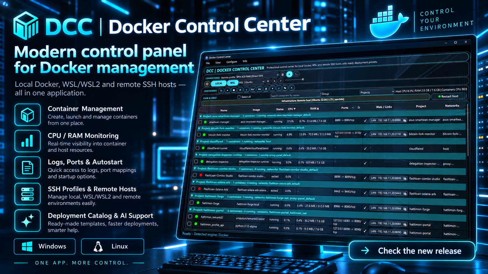
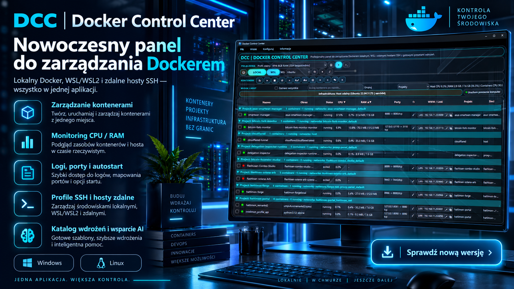
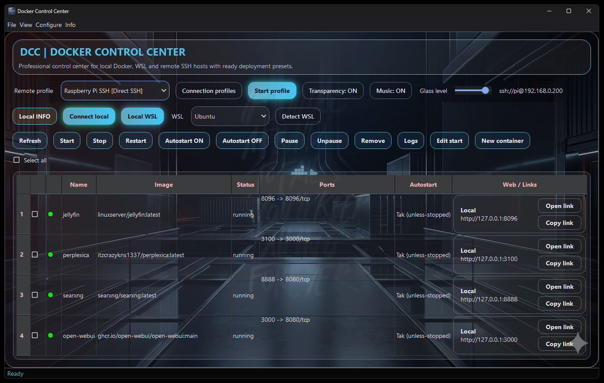
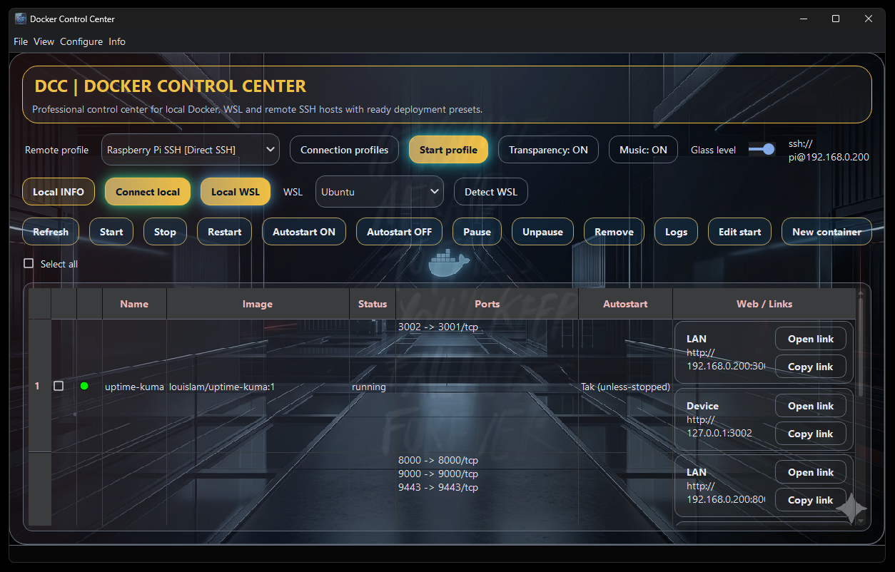
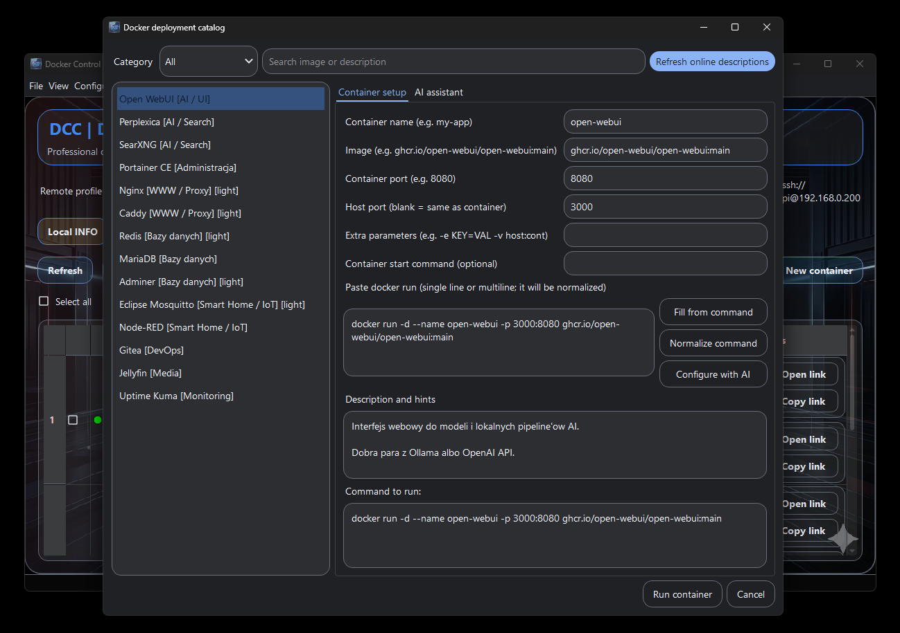
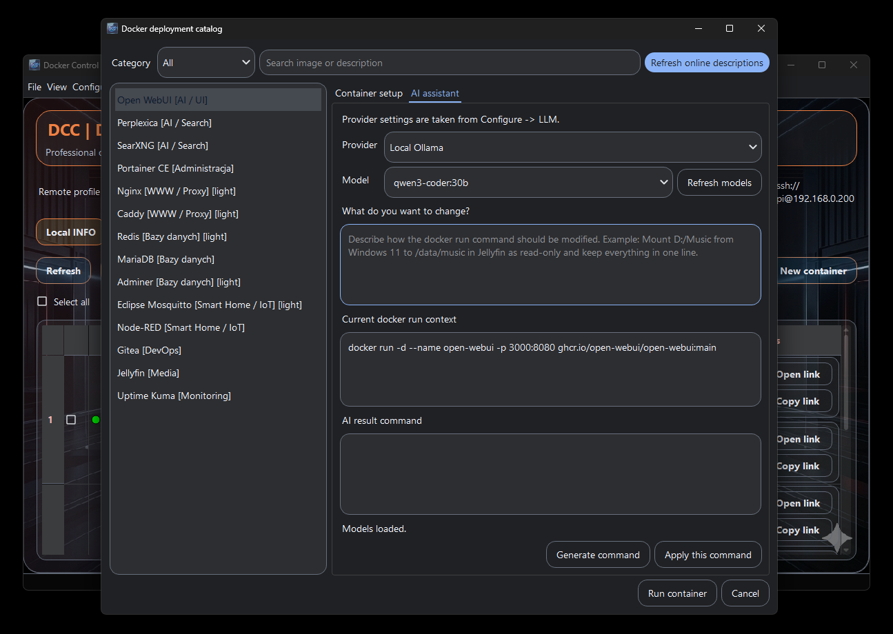
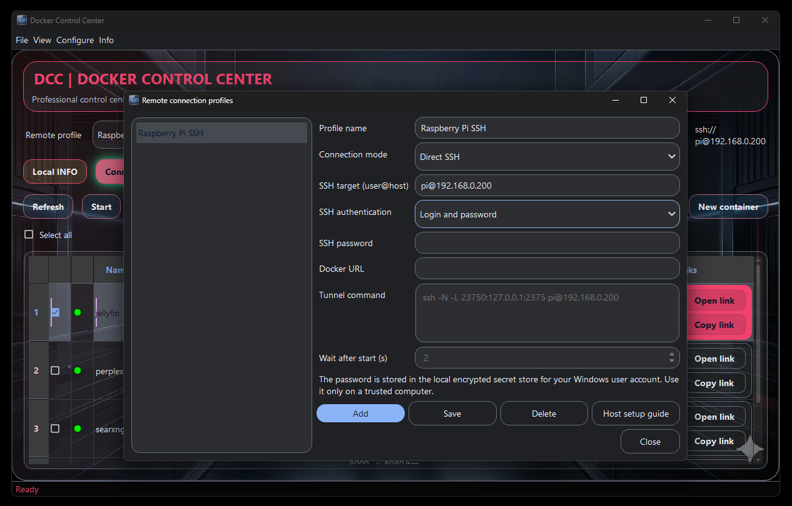

# Docker Control Center

[Jump to Polish / Przejdź do polskiej wersji](#polski)

A cross-platform desktop control panel for managing Docker on Windows and Debian-family Linux, locally, through WSL/WSL2, and on remote hosts over SSH or Balena OS.

### Download Latest Version

DCC Web: Windows, macOS, Linux · Docker Compose.

[Install DCC Web (EN)](https://github.com/hattimon/DCC/blob/dcc-web-v0.2.0/apps/dcc-web/docs/installation.md) · [Instalacja DCC Web (PL)](https://github.com/hattimon/DCC/blob/dcc-web-v0.2.0/apps/dcc-web/docs/installation.pl.md)

Release notes / Opisy wydań: [DCC Desktop 1.3.12](https://github.com/hattimon/DCC/releases/tag/v1.3.12) · [DCC Web 0.2.0](https://github.com/hattimon/DCC/releases/tag/dcc-web-v0.2.0) · [All releases / Wszystkie wydania](https://github.com/hattimon/DCC/releases)

### Automatic DCC Web updates / Automatyczne aktualizacje DCC Web

Install **DCC Container Updater** from **App Store → DCC** in DCC Desktop or DCC Web. For supported Docker installations, enable automatic updates for your DCC Web container in the Updater panel.

Zainstaluj **DCC Container Updater** przez **Sklep aplikacji → DCC** w DCC Desktop lub DCC Web. W obsługiwanej instalacji kontenerowej włącz automatyczne aktualizacje kontenera DCC Web w panelu Updatera.

[DCC Container Updater](apps/container-updater/README.md) · [Installation guide / Instrukcja instalacji](apps/container-updater/README.md#install)

### DCC Desktop — overview / widok aplikacji

## English

### What it does
- Manage local Docker containers from one desktop app.
- Connect to WSL / WSL2 Docker environments.
- Connect to remote Docker hosts over SSH or Balena OS (auto-detected).
- Browse container logs, inspect containers, open web links, and manage autostart.
- Create and modify container run commands with presets and AI-assisted editing.
- Switch between `Light`, `Dark`, and `Black` themes with background artwork support.

### Screenshots
Screenshots below use the English UI.

`Main view - local containers`

`Remote view - SSH-connected containers`

`New container wizard`

`AI assistant`

`New remote profile`

### Distribution
- `Installer`: installs for the current Windows user.
- `Portable`: standalone EXE package with no Python requirement.

### SSH key + passphrase
1. Open `Connection profiles` and add/edit a profile.
2. Set `SSH authentication` to `SSH key + passphrase`.
3. Choose the key file and enter the passphrase.
4. Optional: enable ssh-agent in Windows (see the in-app guide).

### Privacy and security
- User settings are stored per Windows user in `%APPDATA%\DockerControlCenter`.
- API keys and SSH passwords are not stored in the repository.
- Secrets are protected per user with Windows DPAPI.
- The public repository excludes personal profiles, secrets, build folders, and local environment files.

### Included features
- Local Docker management
- WSL / WSL2 integration helpers
- SSH profiles with key, passphrase, or password auth
- Balena OS auto-detection (`balena ps` / `balena run`)
- Curated catalog of 50+ popular images, including lightweight Raspberry Pi options
- AI assistant for `docker run` command editing
- Per-theme custom backgrounds
- Music toggle and futuristic desktop UI
- Context actions, logs, inspect, and link opening

### Example user data files
- `docker_connection_profiles.example.json`
- `%APPDATA%\DockerControlCenter\docker_connection_profiles.json`
- `%APPDATA%\DockerControlCenter\docker_control_center_secrets.json`

---

## Polski

### Co robi aplikacja
- Zarządza lokalnymi kontenerami Docker z jednego okna.
- Łączy się z Dockerem w WSL / WSL2.
- Łączy się ze zdalnymi hostami Docker przez SSH lub Balena OS (automatyczne wykrywanie).
- Wyświetla logi, inspect i linki WWW oraz pozwala ustawić autostart kontenerów.
- Umożliwia tworzenie i edytowanie komend `docker run` z presetami i wsparciem AI.
- Pozwala przełączać motywy `Light`, `Dark` i `Black` oraz korzystać z tapet graficznych.

### Zrzuty ekranu
Poniższe zrzuty przedstawiają interfejs w języku angielskim.

`Widok główny – lokalne kontenery`

`Widok zdalny – kontenery przez SSH`

`Kreator nowego kontenera`

`Asystent AI`

`Dodawanie nowego profilu zdalnego`

### Dystrybucja
- `Installer`: instaluje aplikację dla bieżącego użytkownika Windows.
- `Portable`: samodzielna wersja EXE bez potrzeby instalowania Pythona.

### Klucz SSH + hasło do klucza
1. Otwórz `Profile połączeń` i dodaj lub edytuj profil.
2. Ustaw `Autoryzacja SSH` na `Klucz + hasło do klucza`.
3. Wybierz plik klucza i wpisz hasło.
4. Opcjonalnie włącz ssh-agent w Windows (instrukcja jest dostępna w aplikacji).

### Prywatność i bezpieczeństwo
- Ustawienia użytkownika są przechowywane osobno dla każdego konta Windows w `%APPDATA%\DockerControlCenter`.
- Klucze API i hasła SSH nie są przechowywane w repozytorium.
- Sekrety są chronione za pomocą Windows DPAPI dla konkretnego użytkownika.
- Publiczne repozytorium nie zawiera prywatnych profili, sekretów, plików kompilacji ani lokalnych plików środowiska.

### Najważniejsze funkcje
- Zarządzanie lokalnym Dockerem
- Wsparcie dla WSL / WSL2
- Profile SSH z uwierzytelnianiem kluczem, hasłem do klucza lub hasłem
- Automatyczne wykrywanie Balena OS (`balena ps` / `balena run`)
- Katalog ponad 40 popularnych obrazów, w tym lekkie opcje dla Raspberry Pi
- Asystent AI do edycji komend `docker run`
- Różne tła dla motywów
- Muzyka w tle i futurystyczny interfejs
- Menu kontekstowe, logi, inspect i otwieranie linków

### Przykładowe pliki danych
- `docker_connection_profiles.example.json`
- `%APPDATA%\DockerControlCenter\docker_connection_profiles.json`
- `%APPDATA%\DockerControlCenter\docker_control_center_secrets.json`

## Repository contents
- `docker-menager.ps` - main application source
- `DockerControlCenter.nsi` - NSIS installer script
- `backgrounds/` - theme background artwork
- `images/` - README screenshots
- `icon.ico` / `icon.png` - application icons
- `assets/audio/` - procedural theme ambient and Docker operation sound effects

## Support the project / Wesprzyj projekt

If DCC is useful to you, you can support its continued development on Ko-fi.

Jeżeli DCC jest dla Ciebie przydatny, możesz wesprzeć dalszy rozwój projektu na Ko-fi.

[https://ko-fi.com/hattimon](https://ko-fi.com/hattimon)

## License

DCC is licensed under the MIT License. See [LICENSE](LICENSE).

Projekt DCC jest udostępniany na licencji MIT.

Third-party assets are covered by their respective licenses or ownership terms. See [THIRD_PARTY_NOTICES.md](THIRD_PARTY_NOTICES.md).

Materiały podmiotów trzecich podlegają ich własnym licencjom lub prawom właścicieli.

## DCC Web

DCC Web is the browser-based counterpart to DCC Desktop and runs as a separate service. See the [product overview](https://github.com/hattimon/DCC/blob/dcc-web-v0.2.0/apps/dcc-web/README.md) and the [GitHub repository](https://github.com/hattimon/DCC).

DCC Web provides container management, profiles, logs, monitoring, Compose and the shared App Store, along with themes, local audio, English and Polish, clickable panel links, an AI configuration assistant and scoped MCP tools for authorized read and write operations. See the [installation guide](https://github.com/hattimon/DCC/blob/dcc-web-v0.2.0/apps/dcc-web/docs/installation.md) and [feature matrix](https://github.com/hattimon/DCC/blob/dcc-web-v0.2.0/apps/dcc-web/docs/feature-matrix.md) for setup and adapter limitations. Its Docker image is published in GHCR and listed in the App Store catalog.
