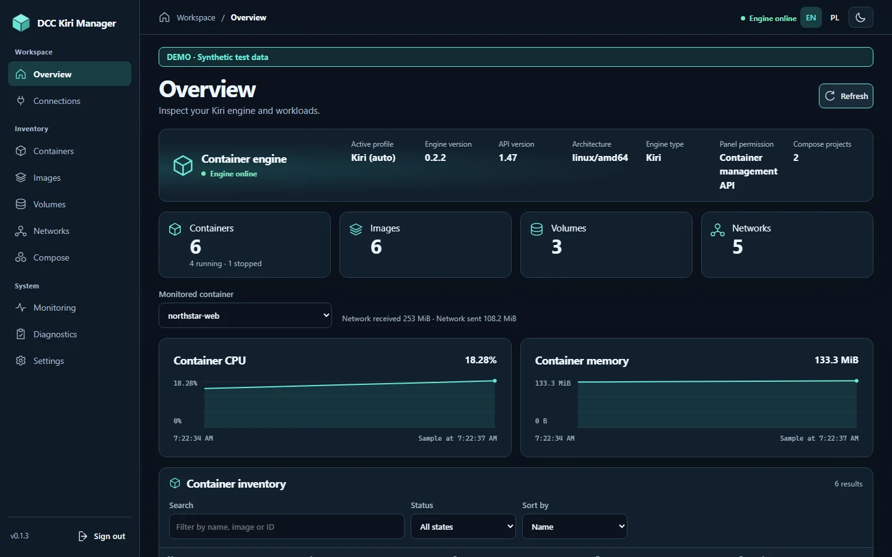

# DCC Kiri Manager 0.1.3 (review candidate)

**Experimental**. An independent browser workspace for Kiri and Docker engines, maintained in the Docker Control Center (DCC) repository. Kiri is developed by libracoder. References to Kiri and Docker identify the software used by the panel.

[Polski](README.pl.md) · [Project site](https://hattimon.github.io/DCC/kiri-manager/) · [GitHub release](https://github.com/hattimon/DCC/releases/tag/kiri-manager-v0.1.2) · [GHCR package](https://github.com/hattimon/DCC/pkgs/container/dcc-kiri-manager) · [Support the author on Ko-fi](https://ko-fi.com/hattimon)

## What it does

- Automatically discovers administrator-provided endpoints, verifies Kiri's engine identity and inventory, and offers **Connect**. Unavailable connections show a concrete blocker and setup guidance.
- Lists containers, images, volumes, networks and Compose services. The panel shows details, bounded logs and recent samples of a selected container.
- Starts, stops, restarts, pauses, resumes and removes stopped containers with explicit confirmation and volume preservation.
- Supports SSH profiles with verified host keys and encrypted password or private-key credentials.
- Saves connection profiles, language, theme and polling interval. A first-run wizard guides setup and can be completed with an unavailable engine.
- Serves a local login with revocable sessions. The package runs as UID/GID 10001.

## Install and connect

**Published version: 0.1.2.** The 0.1.3 candidate is not released; see [review notes](RELEASE_NOTES_0.1.3.md) before testing. Install the published version from the DCC Store under **DCC**, or run `docker compose up -d` from this directory. Open the panel on the Docker host. If no administrator has been configured, enter `admin` as the username and password. Choose a new password and optionally change the username before entering the panel. Expand the terminal help on the sign-in screen for account setup or recovery. [Local panel](http://127.0.0.1:8796) · [Installation and reset instructions](docs/installation.md).

In DCC for Windows, open the Store's **DCC Kiri Manager** entry. DCC checks Kiri's documented Windows named pipe and offers **Connect** or **Install Kiri** (official installer guidance). Once connected to a verified Kiri engine, panel installation requires explicit administrator approval and a successful socket preflight from inside a disposable Kiri container. Failed preflights leave the running panel and `dcc_kiri_manager_data` volume untouched. The web panel automatically discovers only sockets already granted by an administrator; its advanced manual alias wizard is optional. The Debian/Ubuntu helper remains available for administrator-managed installation.

The same image supports Kiri’s Docker-compatible CLI. The Windows named pipe is used by the **desktop application**, while the **Linux web panel container** needs a Unix socket accessible inside its own runtime. Cross-VM and cross-WSL mounts are unverified and are never assumed. See [installation](docs/installation.md) and [compatibility](docs/compatibility.md) for actual evidence and limitations.

## Documentation

- [Kiri source audit and API matrix](docs/kiri-audit.md)
- [Architecture and data storage](docs/architecture.md)
- [HTTP API](docs/api.md)
- [Security](docs/security.md)
- [Release procedure](docs/release.md)
- [Local and GitHub Actions verification](docs/verification.md)

Update by pulling an approved version and recreating only the panel using its existing volume. Back up the panel’s data before upgrading. To remove the panel, run `docker compose down` without volume removal. See the installation guide for rollback and standalone CLI installs.

DCC Kiri Manager uses the [DCC repository MIT license](../../LICENSE). Dependency and artwork details are listed in [third-party notices](docs/licenses.md). [Official Kiri website](https://runkiri.com/).
