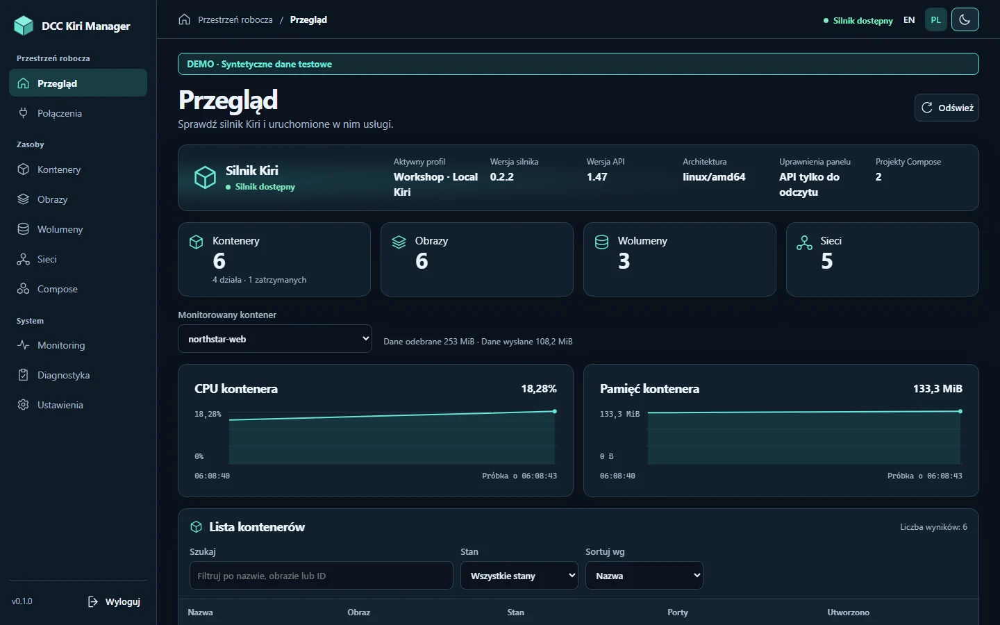

# DCC Kiri Manager 0.1.0

**Wersja eksperymentalna**. Samodzielny panel WWW do odczytu zasobów silnika Kiri w repozytorium Docker Control Center (DCC). Kiri rozwija libracoder. Nazwy Kiri i Docker identyfikują oprogramowanie, z którym współpracuje panel.

[English](README.md) · [Strona projektu po wdrożeniu](https://hattimon.github.io/DCC/kiri-manager/) · [Wydanie GitHub po zatwierdzeniu](https://github.com/hattimon/DCC/releases/tag/kiri-manager-v0.1.0) · [Pakiet GHCR](https://github.com/hattimon/DCC/pkgs/container/dcc-kiri-manager) · [Wsparcie autora na Ko-fi](https://ko-fi.com/hattimon)

## Funkcje

- Rozpoznawanie tożsamości Kiri i negocjacja wersji API na jawnie skonfigurowanym sockecie Unix.
- Odczyt kontenerów, obrazów, wolumenów, sieci i usług Compose. Szczegóły, ograniczony podgląd logów oraz próbki CPU, RAM, sieci i operacji blokowych dla wybranego kontenera.
- Kreator pierwszego uruchomienia oraz trwały zapis profili, języka, motywu i odświeżania. Panel można otworzyć przy niedostępnym silniku.
- Logowanie lokalnego administratora z możliwością unieważnienia sesji. Serwer uruchamia się jako UID/GID 10001.

## Instalacja i połączenie

Po publikacji obrazu uruchom `docker compose up -d` z tego katalogu. Utwórz administratora poleceniem `docker compose exec panel python -m backend.admin` i otwórz [panel lokalny](http://127.0.0.1:8796). Panel zachowuje ustawienia w wolumenie `dcc_kiri_manager_data` i ma własny healthcheck. Gdy wpis pojawi się w Sklepie DCC, możesz zainstalować panel ze sklepu i otworzyć go pod adresem loopback na hoście Docker. Przycisk Website otwiera stronę projektu.

Kreator dobiera oficjalny instalator Kiri do platformy. Wspomagana instalacja na Debianie i Ubuntu weryfikuje pakiet dla architektury komputera i uruchamia usługę po zgodzie na hoście. Administrator udostępnia panelowi dedykowany socket i wybiera jego alias w kreatorze.

Ten sam obraz przygotowano do uruchomienia przez zgodne CLI Kiri. [Instrukcja instalacji](docs/installation.pl.md) obejmuje Docker, Sklep DCC, Kiri, WSL2, Ubuntu, Debiana, Raspberry Pi 4/5 oraz macOS Intel i Apple Silicon. [Macierz zgodności](docs/compatibility.md) podaje zakres dowodów. Potok Windows i sockety między osobnymi VM są poza zakresem konektora OCI w tej wersji.

## Dokumentacja

- [Audyt źródeł Kiri i macierz operacji](docs/kiri-audit.md)
- [Architektura i dane](docs/architecture.md)
- [API panelu](docs/api.md)
- [Bezpieczeństwo](docs/security.md)
- [Procedura wydania](docs/release.md)
- [Lokalna weryfikacja](docs/verification.md)

Aby zaktualizować panel, pobierz zatwierdzoną wersję i odtwórz jego kontener z dotychczasowym wolumenem. Przed aktualizacją zrób kopię danych panelu. `docker compose down` usuwa kontener panelu z zachowaniem wolumenu. Instrukcja opisuje również cofnięcie wersji i instalację przez CLI.

Kod jest objęty [licencją MIT repozytorium DCC](../../LICENSE). Informacje o zależnościach i grafikach zawiera [wykaz licencji](docs/licenses.md). [Oficjalna strona Kiri](https://runkiri.com/).
